# Case 03: Decoupled 3D Digital Twin & High-Frequency Telemetry Gateway

[-purple.svg)](#)

A production-grade reference architecture demonstrating how to decouple heavy, continuous mathematical simulation solvers from web-based 3D visualizations. Implements a high-throughput **Node.js/TypeScript Telemetry Gateway** with delta-compression and WebSocket broadcasting, driving a responsive **Three.js WebGL Digital Twin** at a rock-solid 60 FPS.

---

## 1. System Architecture

```mermaid
flowchart LR
    subgraph Tier1["Tier 1: Simulation Core (Physics Solver)"]
        direction TB
        Solver["Dynamic Physics Solver<br/>• 2,000+ State Signals<br/>• 100 Hz Simulation Tick<br/>• Kinematics & Coordinates"]
    end

    subgraph Tier2["Tier 2: Intermediate Telemetry Gateway (Node.js / TS)"]
        direction TB
        Ingest["Buffer Ingest & Validation"]
        Delta["Delta Compression Engine<br/>Deadband Filtering (|Δs| > ε)"]
        WSHub["WebSocket Broadcast Hub<br/>• Client backpressure management<br/>• 30-60 Hz adaptive streaming"]
        Ingest --> Delta --> WSHub
    end

    subgraph Tier3["Tier 3: Presentation Layer (Three.js WebGL)"]
        direction TB
        WSClient["WebSocket Client Receiver"]
        Lerp["Spatial Interpolation (Lerp/Slerp)<br/>Decouples network tick from render loop"]
        WebGL["Three.js 3D Scene (Vite)<br/>• 60 FPS Guaranteed<br/>• Matrix transforms without GC allocations"]
        WSClient --> Lerp --> WebGL
    end

    Solver -->|IPC / Socket Stream| Ingest
    WSHub -->|Compact Delta Packets| WSClient

    style Tier1 fill:#f9f9f9,stroke:#333,stroke-width:1px
    style Tier2 fill:#e3f2fd,stroke:#1565c0,stroke-width:2px
    style Tier3 fill:#e8f5e9,stroke:#2e7d32,stroke-width:2px
```

---

## 2. The Engineering Problem: Telemetry Overload in WebGL

When building real-time dashboards and digital twins for physical systems (aerospace, robotics, geospatial sensors, or industrial reactors), continuous mathematical solvers output thousands of telemetry variables at high frequencies (100 Hz to 1,000 Hz).

### The Monolithic Anti-Pattern
1. **Event Loop Starvation:** Directly piping high-frequency raw telemetry packets into a browser's WebSocket connection floods the main UI thread with JSON deserialization tasks.
2. **Garbage Collection (GC) Stutters:** Continually instantiating JavaScript objects for thousands of signals per second triggers aggressive V8 garbage collection cycles, causing visible frame drops (stutters down to 15–20 FPS).
3. **Bandwidth Waste:** 80% to 90% of telemetry signals remain unchanged between consecutive frames during steady-state operations, yet naive systems transmit complete state snapshots continuously.

### The Decoupled Solution: 3-Tier Architecture with Delta Streaming
1. **Delta Compression & Deadband Filtering:** The gateway maintains the last acknowledged state vector. A signal is transmitted only if its absolute variation exceeds an engineering deadband:
   $$|\Delta s_i| = |s_i(t) - s_i(t - \Delta t)| > \epsilon_i$$
   This slashes network transmission overhead by **75% to 85%**.
2. **Decoupled Render Interpolation (Lerp / Slerp):** Network packets arrive at 30 Hz or 50 Hz, but the Three.js render loop runs smoothly at 60 Hz or 120 Hz. By applying linear interpolation (Lerp) for spatial positions and spherical linear interpolation (Slerp) for orientation quaternions, the 3D scene renders fluidly without micro-stutters.
3. **Zero-Allocation Render Loops:** Three.js objects update their `matrixWorld` in-place using pre-allocated buffers, eliminating object allocation inside the `requestAnimationFrame` loop.

---

## 3. Mathematical & Protocol Formulation

Given a global system state vector $S(t) \in \mathbb{R}^M$ with $M \ge 1,000$ telemetry channels:

1. **Deadband Filter Function:**
   $$\text{Mask}_i(t) = \begin{cases} 1, & \text{if } |S_i(t) - S_i^{\text{last}}| \ge \epsilon_i \\ 0, & \text{otherwise} \end{cases}$$
2. **Compact Delta Packet Construction:**
   $$\Delta P(t) = \left\{ (i, S_i(t)) \;\middle|\; \text{Mask}_i(t) = 1 \right\} \cup \{\text{Timestamp}_t\}$$
3. **Client-Side Spatial Interpolation:**
   For a 3D component with position $\mathbf{p} \in \mathbb{R}^3$ and orientation quaternion $\mathbf{q} \in \mathbb{H}$:
   $$\mathbf{p}(t) = (1 - \alpha) \mathbf{p}_{\text{prev}} + \alpha \mathbf{p}_{\text{target}}, \quad \alpha = \frac{t - t_{\text{prev}}}{t_{\text{target}} - t_{\text{prev}}}$$
   $$\mathbf{q}(t) = \operatorname{slerp}(\mathbf{q}_{\text{prev}}, \mathbf{q}_{\text{target}}, \alpha)$$

---

## 4. SDD Phased Execution Roadmap

| Phase | Milestone | Objective | Deliverables | Acceptance Criteria |
| :--- | :--- | :--- | :--- | :--- |
| **Phase 1** | Telemetry Protocol & Data Contracts | Define JSON / binary schemas for full state snapshots and delta packets. Specify component geometries. | `schema/full_state.schema.json` `schema/delta_packet.schema.json` `data/mock_telemetry_layout.json` | Valid schemas; at least 1,000 mock variables across 10 distinct 3D assemblies. |
| **Phase 2** | Continuous Physics Engine Simulator | Build a standalone simulation process emitting realistic multi-frequency physics signals (positions, rotations, sensor readings) at 100 Hz. | `simulator/physics_engine.ts` (or `.py`) `tests/test_simulator.ts` | Emits 1,000+ signals at a stable 100 Hz tick rate ($\pm 2\text{ ms}$ jitter); supports steady-state and dynamic transient modes. |
| **Phase 3** | Node.js Telemetry Gateway | Build the gateway with delta-compression, deadband filtering, and a WebSocket broadcast hub. | `gateway/telemetry_server.ts` `gateway/delta_compressor.ts` `tests/test_gateway.ts` | Achieves $> 75\%$ bandwidth reduction under steady state; handles 20 concurrent WebSocket client connections without lag. |
| **Phase 4** | Interactive Three.js WebGL Digital Twin | Build a modern browser 3D client using Vite, TypeScript, and Three.js with camera controls, component binding, and lerp smoothing. | `client/src/main.ts` `client/src/scene_manager.ts` `client/src/telemetry_receiver.ts` | 60 FPS rendering under active streaming; zero memory leaks or runaway GC; smooth interpolation across network intervals. |
| **Phase 5** | Containerized End-to-End Topology | Package Simulator, Gateway, and Web Client into an automated multi-container setup with Docker Compose. | `Dockerfile.gateway` `Dockerfile.client` `docker-compose.yml` | `docker compose up` spins up the entire stack; browser loads 3D scene on `http://localhost:5173` receiving live telemetry immediately. |
| **Phase 6** | Performance Profiling & Article Draft | Profile FPS, latency, and bandwidth under stress (5,000 signals). Produce benchmark charts and article draft for Medium/LinkedIn. | `benchmarks/run_telemetry_benchmark.ts` `ARTICLE_DRAFT.md` | Documented 60 FPS vs 18 FPS (decoupled vs monolithic); article ready for publication following `medium-posts` skill. |
