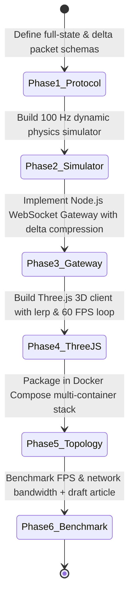

# AGENT INSTRUCTIONS: Case 03 — Decoupled 3D Digital Twin & High-Frequency Telemetry Gateway

**Scope:** Dedicated working rules for the AI coding agent assigned to this isolated sub-repository (`case-03-realtime-3d-telemetry`).

---

## 1. Core Principles & Behavioral Rules

1. **Strict Spec-Driven Development (SDD):**
   * Do NOT implement subsequent phases until the current phase passes its Acceptance Criteria.
   * Do NOT start building the Three.js client in Phase 4 until Phase 3's WebSocket gateway demonstrates delta compression and passes test suites.
   * Every phase ends with a concrete, executable verification test.
2. **Absolute Domain Anonymity (CRITICAL):**
   * Never mention target companies, employers, or interview contexts (zero references to EagleView, Kopius, CNEA, or client names).
   * Frame everything as a generic, open-source 3D digital twin & real-time telemetry architecture for high-concurrency engineering systems.
3. **The 60 FPS Invariant:**
   * The browser-based Three.js 3D rendering loop must maintain a steady **60 FPS** (or 120 FPS on ProMotion displays) without GC stutters or UI freezing under a stream of at least 1,000 active telemetry signals.
   * Any client implementation that allocates new objects inside `requestAnimationFrame` fails acceptance.

---

## 2. Environment & Tooling Baseline

* **Node.js & TypeScript Runtime:**
  * Node.js v20+ / v24+ with TypeScript, `tsx` / `ts-node`, `ws` (WebSockets), `zod` or `ajv` for contracts.
* **Frontend Web Stack:**
  * Vite + TypeScript + Three.js (`three`, `@types/three`), `@types/ws`, `stats.js` (for live FPS/memory profiling).
* **Docker:**
  * Docker Desktop on macOS. Multi-container setup orchestrated via Docker Compose.

---

## 3. Step-by-Step SDD Execution Protocol

### Phase 1: Telemetry Protocol & Data Contracts
* **Action:**
  1. Create `schema/full_state.schema.json`:
     - Dictionary of channel IDs to float64 values (`{ "channel_id": value }`).
     - Timestamp (epoch milliseconds or high-resolution ticks).
  2. Create `schema/delta_packet.schema.json`:
     - Compact payload containing only changed signals: `[[channel_id, new_value], ...]`.
     - Timestamp and sequence number for packet loss detection.
  3. Create `data/mock_telemetry_layout.json`:
     - Defines 1,000 telemetry channels mapping to 3D components (e.g. 10 robotic joints / sub-assemblies with position `[x,y,z]`, rotation quaternions `[qx,qy,qz,qw]`, and auxiliary sensor readings like temperature, stress, pressure).
* **Definition of Done (DoD):** Contracts validate sample JSON payloads; schema tests pass.

### Phase 2: Continuous Physics Simulator
* **Action:**
  1. Implement `simulator/physics_engine.ts`:
     - Runs a continuous simulation loop at **100 Hz** (every 10 ms).
     - Generates periodic dynamic motion (sinusoidal oscillations, transients, steady-state periods) across all 1,000 channels.
     - Emits state buffers over local IPC or internal socket.
  2. Implement `tests/test_simulator.ts`:
     - Verifies tick interval accuracy ($10\text{ ms} \pm 2\text{ ms}$) over 5 seconds.
     - Confirms signal bounds are physically meaningful.
* **Definition of Done (DoD):** Simulator executes cleanly without timer drift.

### Phase 3: Node.js Telemetry Gateway & Delta Compressor
* **Action:**
  1. Implement `gateway/delta_compressor.ts`:
     - Class `DeltaCompressor` with configurable deadband threshold $\epsilon$ (default $0.001$).
     - Computes deltas against cached last-sent state; formats compact packet.
  2. Implement `gateway/telemetry_server.ts`:
     - WebSocket server using `ws` on port 8080.
     - Supports client subscription, periodic broadcast (throttled to 30 Hz or 60 Hz per client), and full snapshot on initial connection.
     - Handles client disconnection and backpressure buffering.
  3. Implement `tests/test_gateway.ts`:
     - Connects 5 mock WebSocket clients.
     - Asserts that steady-state broadcast size is $> 75\%$ smaller than full-state snapshots.
* **Definition of Done (DoD):** Automated gateway tests pass; bandwidth reduction verified.

### Phase 4: Interactive Three.js WebGL Client
* **Action:**
  1. Scaffold frontend in `client/` using Vite + TypeScript + Three.js.
  2. Implement `client/src/scene_manager.ts`:
     - Creates 3D scene, lighting, camera controls (`OrbitControls`), and renders a multi-part 3D assembly (using procedural Three.js meshes like cylinders, boxes, joints).
  3. Implement `client/src/telemetry_receiver.ts`:
     - Connects to WebSocket server.
     - Maintains target state and previous state buffers.
     - In the `requestAnimationFrame` loop, applies **Lerp** for translation and **Slerp** for rotations.
     - Embeds `stats.js` to track real-time FPS and memory usage.
* **Definition of Done (DoD):** Browser renders 3D components moving fluidly at 60 FPS while streaming live 1,000-channel telemetry.

### Phase 5: Containerized End-to-End Topology
* **Action:**
  1. Create `Dockerfile.gateway` and `Dockerfile.client`.
  2. Create `docker-compose.yml` orchestrating:
     - `simulator` (Physics Engine)
     - `gateway` (Node.js WebSocket Server on port 8080)
     - `client` (Vite / Nginx Web Client on port 5173 or 3000)
  3. Test full stack boots via `docker compose up`.
* **Definition of Done (DoD):** Opening `http://localhost:5173` loads the 3D digital twin receiving real-time data immediately with zero manual configuration.

### Phase 6: Performance Profiling & Article Draft
* **Action:**
  1. Implement `benchmarks/run_telemetry_benchmark.ts`:
     - Compares Monolithic Direct Streaming (full state every frame) vs. Decoupled Delta Streaming.
     - Measures: Network bandwidth (KB/s), client FPS drop, CPU load.
  2. Write `ARTICLE_DRAFT.md` following the `medium-posts` guidelines:
     - 30-second TL;DR, SEO keywords (*Three.js digital twin, real-time WebSockets, delta compression, WebGL 60 FPS, decoupled simulation architecture*).
     - Architecture diagrams, performance benchmarks (60 FPS vs 18 FPS).
     - Clean senior engineering takeaways and professional Call-to-Action.
* **Definition of Done (DoD):** `ARTICLE_DRAFT.md` completed and verified.
